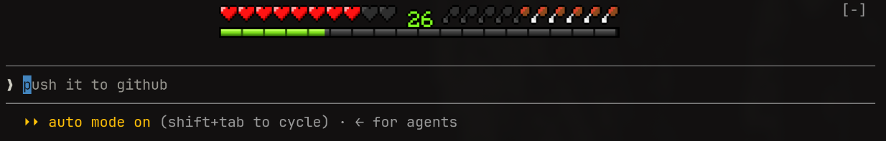

# minecraft-hud

A Claude Code mod that shows your usage as a Minecraft HUD above the prompt.



Close-up of the pixel art:


| HUD | Shows |
| --- | --- |
| ❤️ Health | 5-hour session limit remaining |
| 🍗 Food | Weekly limit remaining |
| 🟩 XP bar + level | Context window used (%) |

Drawn as real pixels on terminals with the kitty graphics protocol (Ghostty, kitty);
elsewhere it shows a one-line text summary. Health and food need a Claude subscription.

## Install

In a Claude Code terminal session:

```
/plugin install minecraft-hud --marketplace <owner>/minecraft-hud
```

Answer `y` to add the marketplace, then press Enter for the user scope.

## Use

- `/hud` hides or shows the HUD.
- The `[-]` beside the HUD collapses it with a click, but only in Claude Code's
  fullscreen layout (`/tui fullscreen`); the classic layout doesn't receive mouse
  clicks. `/tui default` switches back.
- HUD squashed, clipped, or with a gap under it? Adjust `CELL_ASPECT`
  (terminal cell height ÷ width) in `hooks/register.tsx`.

## Develop

```
claude --plugin-dir .          # run with the mod loaded
claude plugin validate .
claude plugin test .
```
